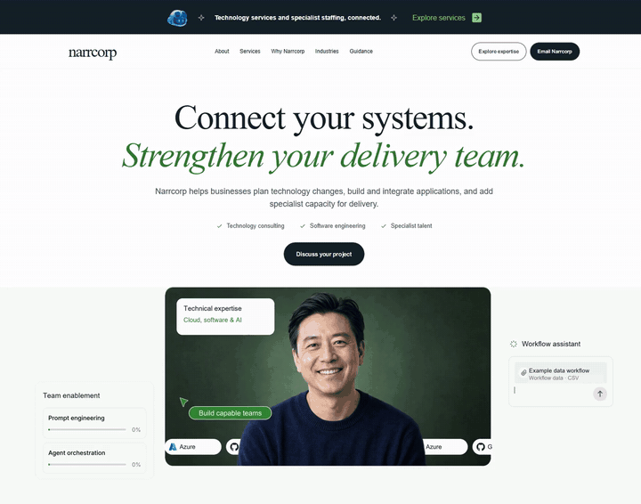
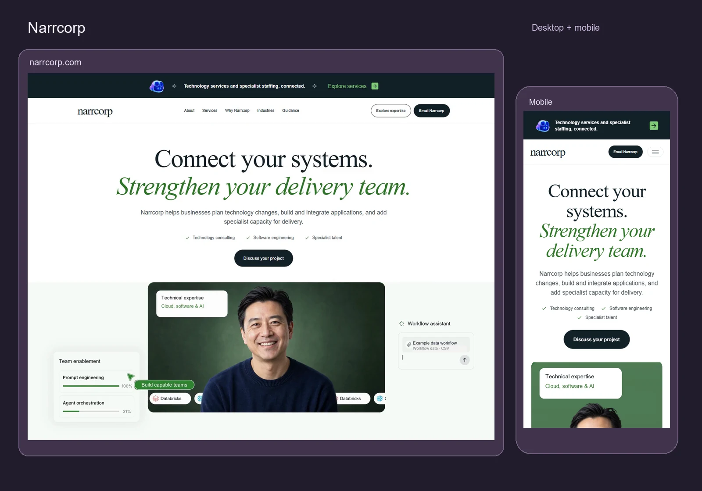

# Narrcorp — website design and delivery

[Live website](https://narrcorp.com/) · [Portfolio](https://attaulhaq-spatial-portfolio.vercel.app/#freelance-web-development) · [Source](https://github.com/attaulhaq0/narrcorp-website)

Narrcorp needed a focused way to present technology services and specialist staffing under one business identity. The landing page connects eight service areas to industry needs, technical disciplines and a direct email contact journey.

## Visual direction and hero motion

Serif headlines, white and mint surfaces, forest-green accents and generous spacing give the technical content an editorial character. The hero pairs the opening headline with layered interfaces, moving platform badges and a professional portrait. Separate desktop, tablet and mobile assets keep the composition responsive. Scroll reveals, industry tabs, the expertise carousel and expandable guidance carry the same visual language through the page.

The looping preview combines the published opening copy with its actual desktop hero animation. The portfolio provides a sharper, silent 16-second video with native play and fullscreen controls.

## Responsive views

## Design and implementation work

- Organized the service content and wrote project-specific website copy, refined through editorial QA.
- Built reusable Astro sections with typed content, regular CSS and static output.
- Refined layered motion, badge loops, portrait composition, platform icons and responsive navigation.
- Implemented keyboard-accessible industry tabs, carousel controls and native guidance disclosures.
- Added canonical metadata, social previews, robots policy, sitemap and structured organization/service data.
- Prepared Hostinger redirects, security/caching configuration and the deployable static artifact.

## Release verification

The November 9, 2026 production verification checked 107 HTTP/release-file conditions and 19 browser interaction checks. Layout checks covered 17 viewport sizes. Local responsive and automated accessibility checks complemented the live checks; automated results do not establish complete WCAG conformance.

Hostinger's Page Speed lab reported desktop 100 and mobile 95 for the tested live release, with CLS 0 in both runs. These are dated lab measurements, not field Core Web Vitals or a guarantee for every device or connection.

The site preserves native content and contact links without JavaScript and responds to the operating system's reduced-motion preference. Client service approval, search-console verification, mailbox setup and physical Safari/iOS/Android checks remain handover tasks.

[Development and Hostinger guide](development-guide.md) · [Publishing checks](publishing.md)
